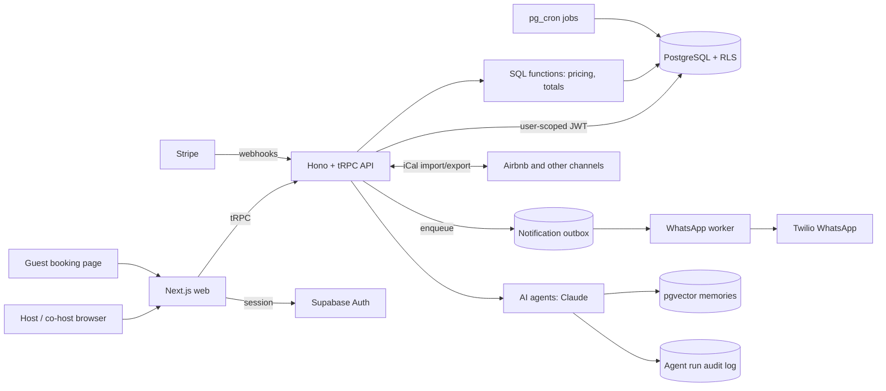

# E-gestour: case study

**A vacation-rental management SaaS for hosts and co-hosts in Brazil.**
Live at **[e-gestour.com.br](https://e-gestour.com.br)** · Source code is private; this repository documents the architecture and my role.

## Problem

Short-term rental hosts, and co-hosts who manage other owners' properties for a commission, run their business across Airbnb calendars, spreadsheets, WhatsApp threads and paper contracts. Double bookings, missed guest messages and manual payout math are the norm. E-gestour puts the whole reservation lifecycle in one place: calendar, bookings, contracts, guest communication and financials.

## My role

**Sole engineer, built for a paying client** (03/2026 – present). I designed and built the whole system: database, API, web app, integrations and deployment. It is in production with real guest bookings. I build with Claude Code as a pair programmer, with Playwright and Vitest suites guarding every change.

## Stack

| Layer | Technology |
|---|---|
| Web | Next.js 14 (App Router), React 18, TypeScript, TanStack Query, Zustand, Tailwind CSS |
| API | Hono + tRPC (end-to-end types), Zod, pino |
| Data | Supabase: PostgreSQL, Auth, Row Level Security, SQL functions, pg_cron, pgvector |
| Integrations | Stripe, Twilio (WhatsApp), Resend, iCal sync (Airbnb and others), S3-compatible storage, PDF generation |
| AI | Claude API agents, embeddings stored in pgvector |
| Ops | Turborepo + pnpm monorepo, Vercel, GitHub Actions, Upstash rate limiting, Playwright + Vitest |

## Architecture



## Technical decisions and trade-offs

- **Two layers of authorization.** The API checks permissions, and PostgreSQL Row Level Security enforces data isolation again at the database level. If an API path has a bug, it still cannot read another host's data. The cost is that every new table needs its policies written and tested, which is why the schema has 82 RLS policies.
- **Pricing in the database.** Price and total calculations run as PostgreSQL functions, so the API, the dashboard and the public booking page always get the same number. The trade-off is logic split between SQL and TypeScript, which I cover with tests on both sides.
- **Money as integer cents everywhere.** No floats are stored or transported; values are formatted only at the presentation layer.
- **Transactional outbox for WhatsApp.** Business operations write a notification row with a dedupe key instead of calling Twilio inline, and a worker delivers the messages. A messaging outage never blocks a booking, and repeated triggers never send a duplicate. See the snippet below.
- **End-to-end types with tRPC.** The web app and the API share procedure types and Zod schemas from one package, so a contract change fails the build instead of failing at runtime.
- **AI agents with guardrails.** Every agent run is written to an audit table, agents run with the minimum scope they need, and sensitive financial actions require a recorded human approval.
- **Environment safety checks in CI.** Scripts assert schema parity between environments, check that previews point at the right database, and fail the run on skipped tests or non-deterministic waits in end-to-end tests.

## Results

- In production with **real guest bookings**.
- **96** tRPC procedures, **30** tables and **82** RLS policies.
- **182** Playwright and Vitest tests.
- Airbnb iCal sync, WhatsApp notifications through the outbox, and scheduled jobs on pg_cron.

## Code sample: non-blocking, idempotent WhatsApp outbox

Sanitized excerpt: comments are translated from Portuguese and the payload is simplified.

```ts
import { supabaseAdmin } from '../config/supabase'
import { normalizePhoneE164BR } from '@egestour/shared'

/**
 * Enqueue a WhatsApp message in the outbox. Never throws: a messaging
 * problem must not abort the booking operation that triggered it.
 */
export async function enqueueWhatsApp(params: {
  phone: string
  event: WhatsAppEvent
  body: string
  entityId: string
  scheduledAt?: Date
  dedupeKey: string
}): Promise<void> {
  try {
    const toPhone = normalizePhoneE164BR(params.phone)
    if (!toPhone) return // no valid phone: the in-app notification is enough

    const { error } = await supabaseAdmin.from('notifications').insert({
      channel: 'whatsapp',
      status: 'pending',
      to_phone: toPhone,
      body: params.body,
      dedupe_key: params.dedupeKey,
      scheduled_at: (params.scheduledAt ?? new Date()).toISOString(),
      entity_type: 'reservation',
      entity_id: params.entityId,
      metadata: { event: params.event },
    })

    // 23505 = unique violation on dedupe_key: the same event was already
    // enqueued by another code path, so this is expected, not an error.
    if (error && error.code !== '23505') {
      console.error('[whatsapp-outbox] enqueue failed:', error.message)
    }
  } catch (err) {
    console.error('[whatsapp-outbox] enqueue failed (non-blocking):', err)
  }
}

/** Cancel a pending message by its dedupe key. Status change, never a delete. */
export async function cancelPendingWhatsApp(dedupeKey: string): Promise<void> {
  /* ... */
}
```

The database enforces idempotency through a unique index on `dedupe_key`, so it holds even when several code paths create the same reservation event at once.
